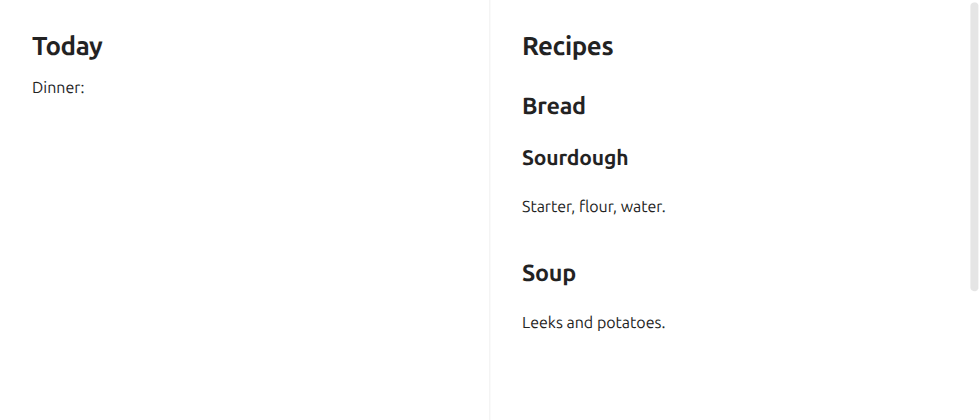

# Heading Links

**Links to headings, readable while you edit.**

Four small things, all in Live Preview:

- `[[Recipes#Bread#Sourdough]]` reads as `Recipes > Bread > Sourdough`
- a heading shows which notes link to it
- the note title shows which notes link to the note
- `+3 headings` next to the title counts the headings other notes link to

<picture><source media="(prefers-color-scheme: dark)" srcset="docs/breadcrumbs-dark.gif"> Bread > Sourdough" src="docs/breadcrumbs-light.gif"></picture>

<picture><source media="(prefers-color-scheme: dark)" srcset="docs/backlinks-dark.gif"></picture>

## Install

Not in the community store. Copy `main.js`, `manifest.json` and `styles.css` into `<vault>/.obsidian/plugins/heading-links/`, or add this repo to [BRAT](https://github.com/TfTHacker/obsidian42-brat).

## In practice

**Breadcrumbs**

Put the cursor on one and the raw link comes back. Click opens the note; ctrl or middle click opens it in a tab.

**Names on a heading or on the title**

Click a name to open the note, ctrl+hover to preview it.

**The count next to the title**

Click it for the list: each heading, with the notes that link to it.

Each of the four can be turned off in the settings. Details and tests: [docs/usage.md](docs/usage.md).
